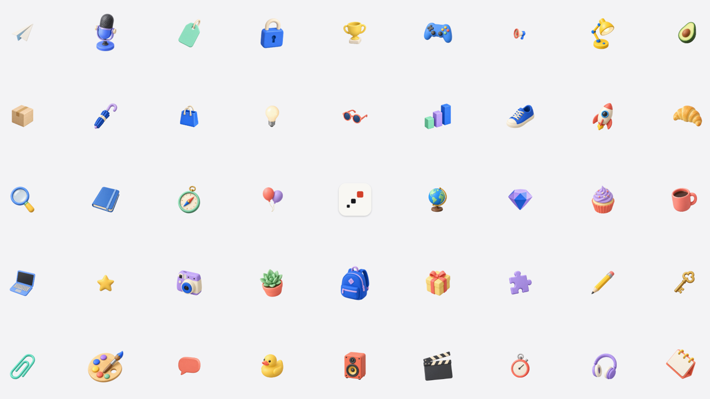
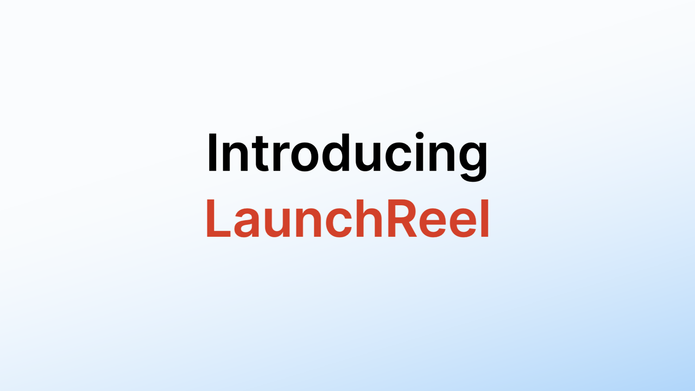

# Icon Cloud Intro — a motion study

A 4-second launch intro rebuilt from scratch as a **motion study**: an app icon sits in the centre, the camera pulls back while 44 items fly in from the lens and settle into a grid, about half of them keep turning on their own, then everything rushes back at the viewer with motion blur and the title rises over a soft gradient.

It ships the same motion three ways — **web (canvas 2D)**, **After Effects**, **Blender** — all driven by one parameter file. It comes **ready to use**: the 44 items are finished soft-3D objects (paper plane, mug, rocket, rubber duck…) and the centre shows the LaunchReel icon as a stand-in for yours. Change the title, swap the centre icon for your own, render.

现成可用:44 个物件是做好的软 3D 图标,中心是 LaunchReel 图标(示例,换成你自己的)。改标题、换中心图标,就能出片。




[Preview (mp4)](media/preview.mp4)

## What the study is about / 学到了什么

The motion is built from **items** (one icon = one unit, like an AE layer or a Blender object) and a handful of curves — no per-frame data:

| Part | How it moves |
|---|---|
| Camera | Pulls back from the centre icon in two eased segments (a slow constant drift, then the main pull-back), eased in log space so the zoom reads evenly |
| Items | Locked to a 9×5 grid. Each starts at its own depth in front of the lens and settles onto the grid plane between its own `t0 → t1`, all with **one shared settle ease** that overshoots slightly |
| Spin | About half of the items turn by themselves (steady spin, start-late spin, or a small sway); the rest stay still |
| Rush | Every item flies outwards with factor `exp(A(t)·(r/1000)^p)` — the further from the centre, the faster — with a per-frame shutter that only opens on the last three frames |
| Title | Line 1 fades in and lifts 15 px; line 2 rises 57 px and fades in a beat later over a gradient that comes up from the corner |

All of it lives in [`canvas2d/build/motion_params.json`](canvas2d/build/motion_params.json); [`generate.py`](canvas2d/build/generate.py) turns it into keyframes.

本仓库是一次公开的动效拆解练习(motion study):把一段发布会开场的运动,按「物件(item)为单位 + 少数几条缓动曲线」从零重建。相机两段缓动拉远;物件锁在 9×5 网格上,各自从镜头前的深度落到网格平面(全部共用一条带轻微回弹的落定缓动);约一半物件自转或摆动;结尾按离中心越远越快的规律冲向镜头,只在最后三帧打开快门;标题两行依次淡入上移。全部参数在 `motion_params.json`,`generate.py` 生成关键帧。

## Use your own icons / 换成你自己的图标

1. Put transparent PNGs in `canvas2d/textures/` (square-ish, 512–1024 px works well).
2. Edit `canvas2d/slot_map.json`: each grid slot id → file name without `.png`; `"icon"` is the centre icon.
3. `python3 canvas2d/build/generate.py canvas2d/slot_map.json canvas2d/textures canvas2d` — sizes are normalised per slot.

把透明 PNG 放进 `canvas2d/textures/`,在 `slot_map.json` 里把槽位指到你的文件名(`icon` 是中心图标),再运行 `generate.py` 即可。

The 44 objects ship at 512 px in `canvas2d/textures/` (named by what they are, e.g. `rubber-duck.png`); keep them, or replace any of them with your own.

## Render / 出片

**Web (canvas 2D)** — Node ≥ 20 + Google Chrome:
```
cd canvas2d && npm install
node render.mjs frames "line1=Introducing&line2=LaunchReel"
ffmpeg -framerate 24 -i frames/%06d.png -pix_fmt yuv420p intro.mp4
```
Open `index.html` through any local server to preview; title lines and colours are query parameters (`line1`, `line2`, `line1Color`, `line2Color`, `fontSize`).

**After Effects** — run `ae/build_ae.jsx` (File → Scripts → Run Script File…) to build the project from `ae/ae_data.json`; the ready-made `.aep` is attached to the release. Install `canvas2d/fonts/Inter-SemiBold.ttf` first.

**Blender** — `blender -b -P blender/build_blend.py -- .` builds `icon-cloud-intro.blend` (textures and font packed in); render with `blender -b blender/icon-cloud-intro.blend -P blender/render_blender.py -- frames/ 0-99` so the rush gets its per-frame shutter. The `.blend` is also attached to the release.

After changing icons or parameters, refresh the AE/Blender data: `node tools/sample_keys.mjs canvas2d/keys.json samples.json && python3 tools/make_ae_data.py samples.json ae/ae_data.json canvas2d/textures`.

## Keyframe format / 关键帧格式

`canvas2d/keys.json` is a plain list of layers, each with a texture, an anchor (0–1 of the texture) and either keyed `frames` (`f, x, y, sx, sy, rot, opacity`; `rot` in degrees clockwise; uniform Catmull-Rom between keys) or eased `segments` (`f0, f1, from, to, ease` with `"linear"` or `{"bezier": [x1, y1, x2, y2]}`). `timeline.shutter` gives the shutter per frame (0 = no blur). [`canvas2d/player.js`](canvas2d/player.js) is the whole player (~100 lines).

## Licence

Code, parameters and gradients: MIT. The 44 object icons (`canvas2d/textures/`, `ae/textures/`, packed in the `.blend`) are ours and free to use in any project, commercial included; please don't resell or redistribute them as an icon pack. The LaunchReel icon and name are our trademark and only a stand-in: replace them before you publish. Font: Inter (SIL Open Font License 1.1, `canvas2d/fonts/Inter-OFL.txt`; `Inter-SemiBold-NoOverlap.ttf` is the same font with overlapping contours merged for Blender).
